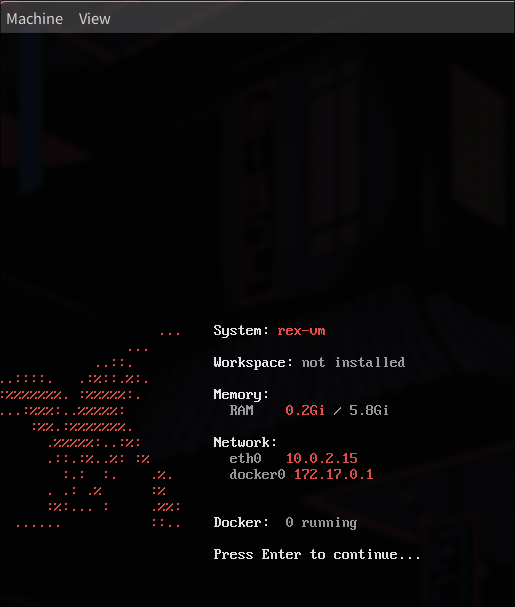
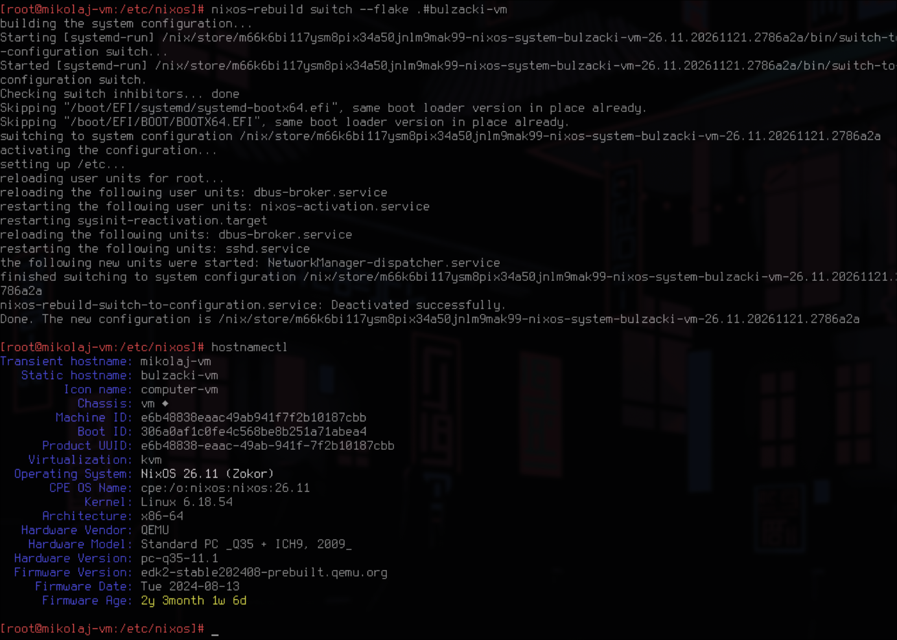
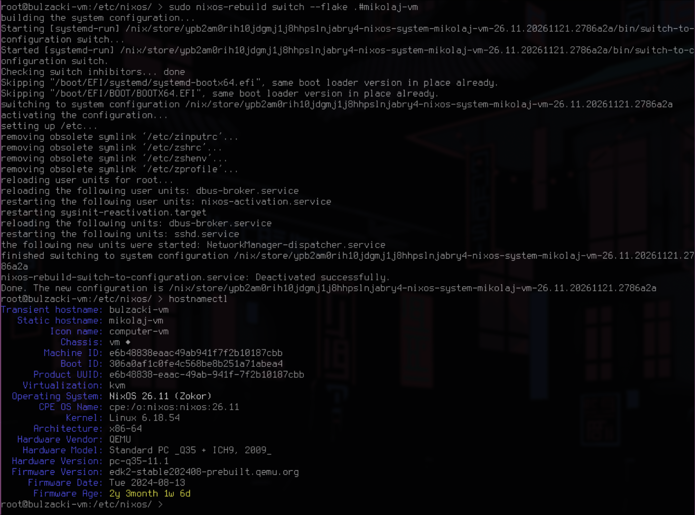
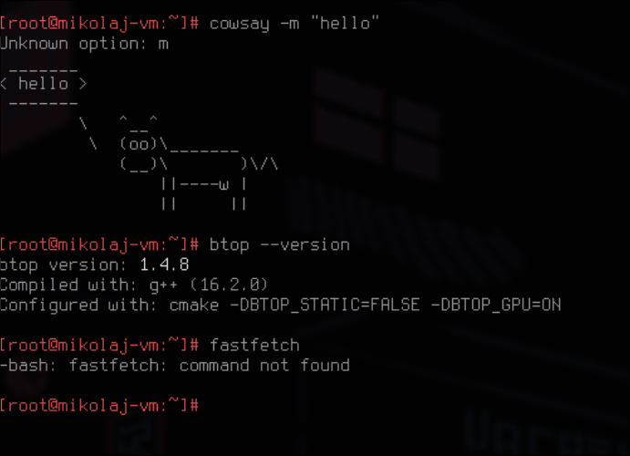
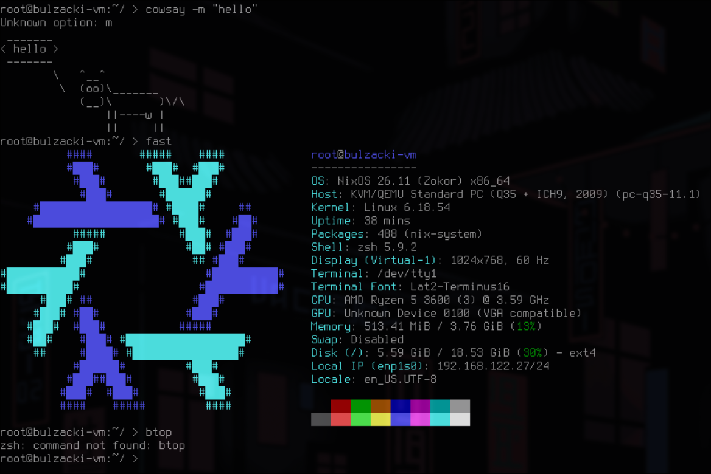
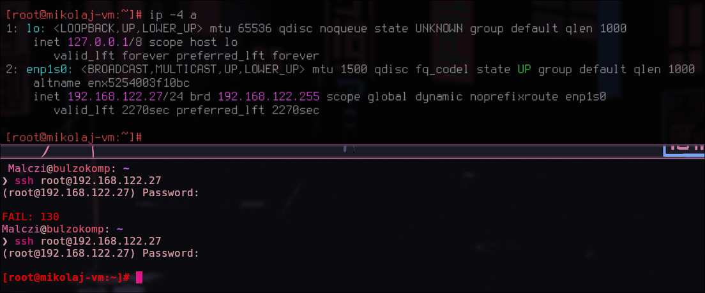

# Sprawozdanie rekrutacyjne devops26

Wykonawca: **Mikołaj Bulzacki**

[TOC]

## Zadanie zerowe

*Rys. 1: Raptors z statystykami z vm*

## Zadanie pierwsze

Przełączenie z hosta `mikolaj-vm` na hosta `bulzacki-vm` zaprezentowano na **[Rys. 2]**. Natomiast z hosta `bulzacki-vm` na hosta `mikolaj-vm` na **[Rys. 3]**

*Rys. 2: Zbudowaniu systemu z konfiguracja hosta bulzacki-vm*

*Rys. 3: Zbudowaniu systemu z konfiguracja hosta mikolaj-vm*

Wykazanie poprawnie zainstalowanych pakietów dla hosta `mikolaj-vm` zaprezentowano na **[Rys. 4]**

*Rys. 4: Pakiety dla hosta mikolaj-vm*

Wykazanie poprawnie zainstalowanych pakietów dla hosta `bulzacki-vm` oraz aktywnej powłoki zsh wraz z aliasem `fast` zaprezentowano na **[Rys. 5]**

*Rys. 5: Pakiety dla hosta bulzacki-vm*

Wykonanie połączenia ssh używając konta root zaprezentowano na **[Rys. 6]**, gdzie na górze znajduje się maszyna wirtualna z wyświetlonym adresem ipv4, a na dole dokonanie połączenia ssh.

*Rys. 6: Połączenie ssh do root dla hosta mikolaj-vm*

